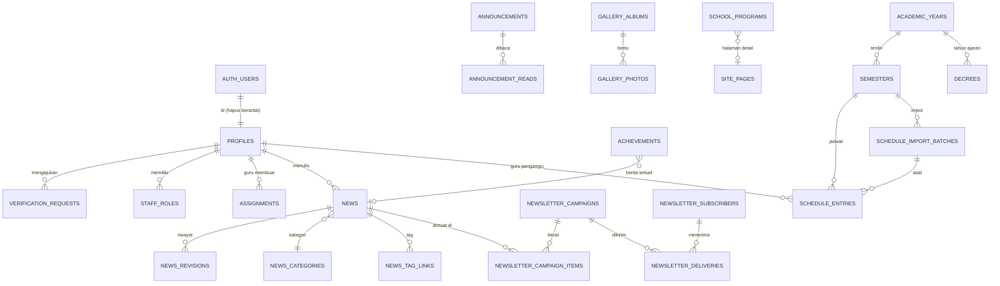

# Panduan Database

Untuk **petugas teknis**. Admin konten tidak perlu membuka database untuk pekerjaan
rutin; semua pekerjaan sehari-hari dilakukan dari dashboard website (`/admin`).

Database proyek ini adalah **PostgreSQL yang dikelola Supabase**. Proyek **tidak**
memakai MySQL/MariaDB Hostinger, jadi hPanel dan phpMyAdmin **tidak** dipakai untuk data
website. Hostinger (bila dipakai) hanya menjalankan aplikasi Next.js.

> Jangan menulis kata sandi, token, atau service role key di dokumen ini atau di
> repository. Data proyek produksi (nama proyek, project ref, region, paket) dicatat
> di bagian 13 setelah proyek dibuat.

Daftar isi:
1. Siapa memakai apa
2. Membuka Supabase Dashboard
3. Prinsip keamanan data
4. Peta tabel per modul
5. Diagram relasi
6. Penyimpanan file (Storage)
7. Fungsi database yang dipanggil aplikasi
8. Migrasi
9. Kueri baca-saja yang aman
10. Prosedur standar
11. Pemantauan rutin
12. Larangan
13. Data proyek produksi (diisi sekolah)

---

## 1. Siapa memakai apa

| Peran | Alat | Untuk |
|-------|------|-------|
| Super Admin, Admin Website, Editor, Petugas Administrasi | **Dashboard website** (`/admin`) | Semua pekerjaan konten & administrasi |
| Petugas teknis | **Supabase Dashboard** + repository GitHub | Migrasi, pemeriksaan data/relasi, RLS, log, backup, prosedur darurat |
| Guru, siswa, Guru BK | Dashboard website (`/dashboard/...`) | Tidak pernah mengakses database langsung |

Akses Supabase Dashboard hanya untuk petugas teknis yang ditunjuk sekolah. Undang lewat
**Organization → Team/Members** dengan peran seminimal mungkin. Akun dasbor Supabase
**terpisah** dari akun login website. Cabut aksesnya ketika petugas berganti tugas.

Petugas teknis bukan peran di aplikasi. Website **tidak** menyediakan halaman untuk
menjalankan SQL; Super Admin cukup melihat **Status Sistem** (`/admin/status`) dan
**Log Aktivitas** (`/admin/log`).

## 2. Membuka Supabase Dashboard

1. Buka <https://supabase.com/dashboard> dan masuk dengan akun petugas teknis (aktifkan 2FA).
2. Pilih organisasi sekolah, lalu proyek produksi (lihat bagian 13).
3. Menu yang dipakai (nama menu dapat sedikit berubah mengikuti versi dasbor):

| Menu | Untuk | Catatan |
|------|-------|---------|
| **Table Editor** | Melihat isi tabel | Anggap **baca saja**. Mengubah data di sini melewati validasi aplikasi |
| **Database → Schema Visualizer** | Melihat relasi antartabel | Lihat juga bagian 5 |
| **Authentication → Policies** | Kebijakan RLS tiap tabel | Semua tabel `public` wajib "RLS enabled" |
| **Authentication → Users** | Akun login | Hapus akun hanya lewat prosedur 10.5 |
| **Authentication → Providers / URL Configuration** | Google OAuth, Site URL, redirect | Lihat `docs/google-oauth.md` |
| **Storage** | Bucket file | Lihat bagian 6 |
| **Logs** | Log API, Auth, Postgres | Untuk menelusuri error |
| **Database → Backups** | Status backup | Tergantung paket; lihat `PANDUAN_BACKUP_PEMULIHAN.md` |
| **SQL Editor** | Prosedur terdokumentasi & kueri bagian 9 | Jangan menjalankan SQL dari sumber tidak jelas |
| **Project Settings → API** | URL & kunci untuk environment hosting | Service role key **rahasia** |

## 3. Prinsip keamanan data

- **Row Level Security (RLS) aktif di semua tabel `public`.** Aplikasi memakai sesi
  pengguna sehingga database sendiri yang menentukan baris yang boleh dibaca/diubah.
  Halaman **Status Sistem** memperingatkan bila ada tabel tanpa RLS.
- **Service role key melewati RLS.** Hanya dipakai di server untuk alur tertentu
  (unggah file, langganan publik, pengiriman email, unduh PDF setelah pemeriksaan hak,
  daftar pengguna). Tidak pernah dikirim ke browser.
- **Peran tidak pernah diambil dari metadata login** (termasuk Google). Peran dan status
  hanya berubah lewat fungsi database yang memeriksa admin.
- **Fungsi `SECURITY DEFINER`** selalu memakai `set search_path = ''` dan memeriksa izin
  di awal. Hak `EXECUTE` diberikan eksplisit per fungsi.
- **Data sensitif dipisah:** NIP/NIS hanya di `verification_requests` dan `school_roster`
  (admin saja); email pelanggan hanya di tabel `newsletter_*`; file SK di bucket privat.
- **Jejak perubahan:** `admin_audit_log` mencatat tindakan admin dan perubahan konten
  penting (lihat bagian 4). Tidak ada hak hapus/ubah log dari aplikasi.

## 4. Peta tabel per modul

Kolom "Ubah langsung?" menjawab apakah petugas teknis boleh mengubah data lewat Table
Editor. Jawaban hampir selalu **tidak**: gunakan dashboard website agar validasi, RLS,
log, dan revalidasi halaman berjalan.

### Akun & peran
| Tabel | Isi | Ubah langsung? |
|-------|-----|----------------|
| `profiles` | Satu baris per akun: nama, peran (`admin`/`guru`/`siswa`/`guru_bk`), status (`pending`/`active`/`disabled`), kelas siswa | **Tidak** (kecuali prosedur 10.1 & 10.2); gunakan `/admin/pengguna` |
| `verification_requests` | Pengajuan guru/siswa, memuat NIP/NIS | Tidak; `/admin/verifikasi` |
| `school_roster` | Data induk NIP/NIS untuk sinyal verifikasi | Impor CSV oleh petugas berwenang (prosedur 10.4) |
| `staff_roles` | Peran staf: `admin_website`, `editor`, `administrasi` | Tidak; `/admin/pengguna` |
| `app_settings` | Pengaturan aplikasi (mode buletin, domain Workspace) | Tidak; `/admin/pengaturan` |
| `admin_audit_log` | Log tindakan admin & perubahan konten (judul + nama kolom, tanpa isi) | Hanya dibaca |

### Berita & CMS
| Tabel | Isi | Ubah langsung? |
|-------|-----|----------------|
| `news` | Berita; `content_html` sudah disanitasi server; status `draft`/`review`/`published`/`archived` | Tidak; `/admin/berita` |
| `news_revisions` | Riwayat perubahan berita (otomatis) | Hanya dibaca |
| `news_categories`, `news_tags`, `news_tag_links` | Kategori & tag | Tidak; CMS |

### Konten situs
| Tabel | Isi | Ubah langsung? |
|-------|-----|----------------|
| `site_profile` | Satu baris: hero, logo, kontak, media sosial | Tidak; `/admin/profil-sekolah` |
| `site_pages` | Halaman profil (HTML tersanitasi) | Tidak; `/admin/halaman` |
| `school_programs` | Program unggulan | Tidak; `/admin/program` |
| `gallery_albums`, `gallery_photos` | Galeri (album terbit wajib konfirmasi izin foto) | Tidak; `/admin/galeri` |
| `achievements` | Prestasi | Tidak; `/admin/prestasi` |
| `calendar_events` | Kalender kegiatan (publik/internal) | Tidak; `/admin/kalender` |
| `announcements`, `announcement_reads` | Pengumuman (publik & internal) dan tanda sudah dibaca | Tidak; `/admin/pengumuman` |

### Administrasi sekolah
| Tabel | Isi | Ubah langsung? |
|-------|-----|----------------|
| `academic_years`, `semesters` | Tahun ajaran & semester (satu aktif) | Tidak; `/admin/tahun-ajaran` |
| `schedule_entries` | Jadwal pelajaran (`semester_id`, `import_batch_id`) | Tidak; `/admin/jadwal` |
| `schedule_import_batches` | Pratinjau & riwayat impor (laporan per baris) | Tidak; `/admin/jadwal/impor` |
| `assignments` | Tugas & materi guru | Tidak; dikelola guru |
| `decrees` | Metadata arsip SK; file di bucket privat `documents` | Tidak; `/admin/arsip-sk` |
| `library_items` | Koleksi perpustakaan digital | Tidak; `/admin/perpustakaan` |

### Ruang Rasa (sangat sensitif)
| Tabel | Isi | Ubah langsung? |
|-------|-----|----------------|
| `rasa_reports` | Laporan: kode, hash PIN, kategori, status; **isi terenkripsi** | **Jangan.** Tidak ada hak tabel untuk peran mana pun selain service role; Table Editor Dashboard akan menampilkan teks sandi |
| `rasa_messages` | Balasan petugas/pelapor (terenkripsi) | Jangan |
| `rasa_handlers` | Guru BK yang ditugaskan | Tidak; `/admin/ruang-rasa` |
| `rasa_access_log` | Catatan pembukaan/penghapusan tanpa isi | Tidak |

Kolom `app_settings.rasa_retention_months` dan `rasa_notice` diatur lewat `/admin/ruang-rasa`.
Isi dienkripsi di aplikasi dengan `RASA_ENCRYPTION_KEY`; petugas teknis tidak perlu dan
tidak boleh mencoba membaca isi laporan. Lihat `PANDUAN_RUANG_RASA.md` §5.

### Langganan berita (memuat alamat email)
| Tabel | Isi | Ubah langsung? |
|-------|-----|----------------|
| `newsletter_subscribers` | Pelanggan & status | **Tidak**; `/admin/langganan` |
| `newsletter_confirmation_tokens` | Token konfirmasi (hash) | Tidak; dibersihkan otomatis |
| `newsletter_suppression_records` | Daftar penolakan (hash email) | Tidak |
| `newsletter_templates`, `newsletter_campaigns`, `newsletter_campaign_items` | Templat & kampanye | Tidak; `/admin/langganan` |
| `newsletter_deliveries`, `newsletter_delivery_events` | Status pengiriman per penerima | Tidak |
| `rate_limit_hits` | Anti-spam sementara | Dibersihkan otomatis |

## 5. Diagram relasi

Diagram ringkas (kolom kunci saja). GitHub menampilkan diagram ini sebagai gambar.



Perilaku hapus yang perlu diketahui:
- Menghapus akun di **Authentication → Users** menghapus `profiles` dan, berantai,
  pengajuan verifikasi, peran staf, tanda baca pengumuman, **serta tugas & materi milik
  guru tersebut**. Konten lain (berita, SK, jadwal) tetap ada dengan kolom penulis
  menjadi kosong. Karena itu, **nonaktifkan** akun alih-alih menghapus (prosedur 10.3).
- Semester yang masih punya jadwal, dan tahun ajaran yang masih punya semester, **tidak
  dapat dihapus** (dijaga database).

## 6. Penyimpanan file (Storage)

| Bucket | Akses baca | Isi | Batas |
|--------|------------|-----|-------|
| `news-images` | Publik lewat URL | Gambar berita & gambar di halaman | 5 MB, JPG/PNG/WebP |
| `site-media` | Publik lewat URL | Logo, hero, galeri, prestasi, program, sampul perpustakaan | 5 MB, JPG/PNG/WebP |
| `documents` | **PRIVAT** | PDF SK (`sk/…`) & PDF perpustakaan (`perpustakaan/…`) | 10 MB, PDF |

- Tidak ada policy tulis untuk browser. Semua unggahan lewat server setelah izin dan isi
  file (magic bytes) diperiksa. Nama file acak per tahun/bulan; nama asli tidak disimpan.
- File di `documents` hanya dapat dibuka lewat tautan sementara 60 detik yang dibuat
  server setelah RLS memastikan pengguna berhak. **Jangan pernah** mengubah bucket ini
  menjadi publik; halaman Status Sistem memperingatkan bila hal itu terjadi.
- Menghapus SK/koleksi dari dashboard ikut menghapus PDF-nya. Menghapus berita atau foto
  **tidak** otomatis menghapus file gambar; lihat prosedur 10.7 untuk file yatim.

## 7. Fungsi database yang dipanggil aplikasi

Fungsi-fungsi ini adalah satu-satunya jalur untuk operasi sensitif. Jangan memanggilnya
manual kecuali disebut di prosedur.

| Fungsi | Dipanggil oleh | Kegunaan |
|--------|----------------|----------|
| `is_admin()`, `is_active_member()`, `current_active_role()`, `current_student_class()` | RLS | Pemeriksaan peran |
| `can_publish_news()`, `can_write_news()`, `can_manage_school_admin()`, `can_manage_library()` | RLS & aplikasi | Kewenangan staf |
| `submit_verification_request()`, `admin_review_verification()` | Akun / admin | Alur verifikasi |
| `admin_set_user_access()`, `admin_set_student_class()`, `admin_set_staff_roles()` | Super Admin | Peran, status, kelas (tercatat di log) |
| `set_active_semester()`, `list_active_teachers()` | Pengelola jadwal | Semester aktif, daftar guru (id & nama saja) |
| `commit_schedule_import()`, `revert_schedule_import()` | Pengelola jadwal | Impor jadwal tanpa menimpa; pembatalan per batch |
| `newsletter_*` | Server (service role) | Konfirmasi, kirim, berhenti berlangganan, anonimkan |
| `newsletter_purge_stale()`, `school_purge_stale()` | Cron | Pembersihan data kedaluwarsa |
| `rasa_list_reports()`, `rasa_get_report()`, `rasa_reply()`, `rasa_set_status()` | Guru BK ditugaskan | Membaca & menangani laporan (pembukaan dicatat) |
| `admin_set_rasa_handler()`, `admin_rasa_overview()` | Super Admin | Penugasan petugas, ringkasan tanpa isi |
| `rasa_submit()`, `rasa_reporter_*()`, `rasa_handler_ids()`, `rasa_purge_expired()` | Server (service role) | Alur pelapor anonim, notifikasi, penghapusan otomatis laporan selesai lewat masa simpan |
| `admin_system_status()` | Super Admin (`/admin/status`) | Pemeriksaan kesehatan baca-saja |
| `audit_content_change()` | Trigger | Mencatat perubahan konten ke log |

## 8. Migrasi

Struktur database **hanya** berubah lewat file di `supabase/migrations/` yang masuk
lewat GitHub dan sudah lolos CI. Jangan membuat/mengubah tabel lewat Table Editor.

Urutan saat ini (semuanya aditif):

| File | Isi |
|------|-----|
| `20261014000100_fondasi_peran_berita.sql` | Profil, peran, verifikasi, berita, pengaturan, log audit |
| `20261014000200_langganan_berita.sql` | Langganan berita email |
| `20261015000100_dashboard_peran.sql` | Pengumuman, jadwal, tugas & materi |
| `20261016000100_status_berita_review.sql` | Status berita `review` |
| `20261016000200_cms_berita.sql` | Peran staf, kategori/tag, revisi, bucket `news-images` |
| `20261017000100_audiens_publik.sql` | Audiens pengumuman `publik` |
| `20261017000200_konten_situs.sql` | Profil sekolah, halaman, program, galeri, prestasi, kalender, bucket `site-media` |
| `20261018000100_peran_administrasi.sql` | Peran staf `administrasi` |
| `20261018000200_tahun_ajaran_dokumen.sql` | Tahun ajaran, impor jadwal, arsip SK, perpustakaan, bucket `documents` |
| `20261019000100_operasional.sql` | Log perubahan konten, status sistem, pembersihan |

Menerapkan migrasi ke produksi:

1. Pastikan CI hijau di GitHub (job *database* menjalankan semua migrasi dan uji RLS).
2. Di komputer petugas: `npm ci`, lalu `npm run test:db` (butuh PostgreSQL lokal).
3. **Buat/konfirmasi backup terbaru** (`PANDUAN_BACKUP_PEMULIHAN.md`). Jangan lanjut tanpa backup.
4. `npx supabase login`, `npx supabase link --project-ref <project-ref>`.
5. `npx supabase db push --dry-run` untuk melihat migrasi yang akan diterapkan, lalu
   `npx supabase db push`.
6. Buka `/admin/status` sebagai Super Admin: periksa "Migrasi terakhir", tidak ada tabel
   tanpa RLS, dan bucket sesuai.
7. Bila gagal di tengah: jangan mengedit tabel manual. Catat pesan error, hentikan, dan
   hubungi pengembang. Migrasi Supabase berjalan per file dalam transaksi.

Migrasi yang **menghapus** tabel/kolom/data tidak boleh dibuat tanpa persetujuan
tertulis sekolah dan backup yang sudah diuji.

## 9. Kueri baca-saja yang aman

Untuk dijalankan petugas teknis di **SQL Editor**. Semuanya `SELECT` (tidak mengubah
data). Hindari menyalin hasil yang memuat data pribadi ke luar dasbor.

```sql
-- Akun per peran & status
select role, status, count(*) from public.profiles group by 1, 2 order by 1, 2;

-- Super Admin aktif (minimal 2 disarankan)
select p.full_name, u.email, u.last_sign_in_at
  from public.profiles p join auth.users u on u.id = p.id
 where p.role = 'admin' and p.status = 'active';

-- Peran staf aktif
select s.role, p.full_name, s.granted_at
  from public.staff_roles s join public.profiles p on p.id = s.user_id
 order by s.role, p.full_name;

-- Tabel public tanpa RLS (harus kosong)
select relname from pg_class c join pg_namespace n on n.oid = c.relnamespace
 where n.nspname = 'public' and c.relkind = 'r' and not c.relrowsecurity;

-- Bucket penyimpanan dan sifatnya
select id, public, file_size_limit from storage.buckets order by id;

-- Ukuran tabel terbesar
select relname, pg_size_pretty(pg_total_relation_size(c.oid)) as ukuran
  from pg_class c join pg_namespace n on n.oid = c.relnamespace
 where n.nspname = 'public' and c.relkind = 'r'
 order by pg_total_relation_size(c.oid) desc limit 15;

-- Semester aktif & jumlah jadwalnya
select y.name, s.term, (select count(*) from public.schedule_entries e where e.semester_id = s.id) as sesi
  from public.semesters s join public.academic_years y on y.id = s.academic_year_id
 where s.is_active;

-- Siswa aktif per kelas (untuk memeriksa penulisan kelas yang tidak konsisten)
select class_name, count(*) from public.profiles
 where role = 'siswa' and status = 'active' group by 1 order by 1;

-- Kelas di jadwal yang tidak punya siswa aktif (kemungkinan salah tulis)
select distinct e.class_name from public.schedule_entries e
 where e.semester_id = public.active_semester_id()
   and not exists (select 1 from public.profiles p where p.role = 'siswa' and p.status = 'active' and p.class_name = e.class_name);

-- Aktivitas admin 7 hari terakhir
select l.created_at, p.full_name, l.action, l.details ->> 'label' as data
  from public.admin_audit_log l left join public.profiles p on p.id = l.actor_id
 where l.created_at > now() - interval '7 days' order by l.created_at desc;

-- Antrean & kegagalan email 7 hari
select status, count(*) from public.newsletter_deliveries
 where created_at > now() - interval '7 days' group by 1;
```

## 10. Prosedur standar

Setiap prosedur yang mengubah data: catat tanggal, petugas, dan alasan di buku log
operasional sekolah. Perubahan lewat fungsi admin otomatis masuk `admin_audit_log`.

### 10.1 Membuat Super Admin pertama (sekali saja)
1. Daftarkan akun lewat situs (email atau Google) memakai email pengelola resmi.
2. Di **SQL Editor** (ganti emailnya):
   ```sql
   update public.profiles
      set role = 'admin', status = 'active', verified_at = now()
    where id = (select id from auth.users where email = 'pengelola@sekolah.sch.id');
   ```
3. Super Admin berikutnya ditetapkan dari `/admin/pengguna`. Segera tetapkan **satu admin
   cadangan**.

### 10.2 Memulihkan akses bila semua Super Admin terkunci
Gunakan hanya bila tidak ada Super Admin aktif yang bisa masuk.
1. Pastikan identitas pemohon lewat kanal resmi sekolah (tatap muka/surat tugas).
2. Jalankan perintah 10.1 untuk akun yang ditunjuk kepala sekolah.
3. Bila akun itu dinonaktifkan, aktifkan juga login-nya: **Authentication → Users →
   (akun) → Unban user** (atau masuk ke `/admin/pengguna` dengan admin lain dan aktifkan).
4. Catat di buku log; minta admin yang dipulihkan memeriksa `/admin/log`.

### 10.3 Menonaktifkan akun (guru pindah, siswa lulus, akun disalahgunakan)
Lakukan dari `/admin/pengguna` → status **Nonaktif**. Efeknya: semua akses RLS hilang
seketika, sesi login diblokir, data milik akun tetap tersimpan. Bisa diaktifkan kembali.
Ini adalah cara yang disarankan dibanding menghapus akun.

### 10.4 Mengimpor data induk NIP/NIS (`school_roster`)
1. Siapkan CSV dengan kolom `kind` (`guru`/`siswa`), `identifier`, `full_name`, `class_name`.
2. **Table Editor → school_roster → Insert → Import data from CSV**.
3. Hapus file CSV dari komputer setelah impor. Tabel ini hanya dapat dibaca Super Admin.

### 10.5 Permintaan penghapusan data pribadi
- **Pelanggan buletin:** `/admin/langganan` → **Hapus/anonimkan**. Email diganti, hash
  tetap di daftar penolakan agar tidak dikirimi lagi.
- **Akun website:** nonaktifkan dulu (10.3). Bila sekolah memutuskan akun benar-benar
  dihapus, petugas teknis menghapusnya di **Authentication → Users → Delete user**.
  Ingat efek berantai di bagian 5 (tugas & materi guru ikut terhapus). Bila akun guru
  punya materi yang masih dipakai, minta guru lain membuat ulang materi itu terlebih dulu.
- Catat permintaan dan tanggal penyelesaian di buku log.

### 10.6 Memeriksa siapa mengubah sesuatu
Super Admin membuka `/admin/log` (saring jenis data). Petugas teknis dapat memakai kueri
"Aktivitas admin" di bagian 9. Riwayat isi berita ada di halaman berita → **Riwayat**.

### 10.7 Membersihkan file gambar yatim (berkala, mis. per semester)
File gambar yang tidak lagi dipakai (berita/foto dihapus) tetap ada di bucket.
1. Lakukan hanya setelah backup Storage (`PANDUAN_BACKUP_PEMULIHAN.md`).
2. Untuk bucket `site-media`, cari file yang tidak dirujuk:
   ```sql
   select o.name, o.created_at
     from storage.objects o
    where o.bucket_id = 'site-media'
      and o.created_at < now() - interval '30 days'
      and not exists (select 1 from public.gallery_photos g where g.image_url like '%' || o.name)
      and not exists (select 1 from public.achievements a where a.image_url like '%' || o.name)
      and not exists (select 1 from public.school_programs s where s.image_url like '%' || o.name)
      and not exists (select 1 from public.library_items l where l.cover_image_url like '%' || o.name)
      and not exists (select 1 from public.site_profile p where p.logo_url like '%' || o.name or p.hero_image_url like '%' || o.name)
    order by o.created_at;
   ```
   Untuk `news-images`, periksa terhadap `news.cover_image_url` dan `news.content_html`.
3. Tinjau daftarnya, lalu hapus dari menu **Storage** (bukan dengan `DELETE` SQL).

### 10.8 Mengganti (rotasi) kunci rahasia
Lakukan bila kunci bocor atau petugas yang memegangnya berganti.
| Kunci | Cara | Dampak |
|-------|------|--------|
| `SUPABASE_SERVICE_ROLE_KEY` | Supabase → Project Settings → API (rotasi JWT/API keys sesuai menu dasbor), lalu perbarui environment hosting & redeploy | Semua sesi login mungkin perlu masuk ulang bila JWT secret dirotasi |
| `NEWSLETTER_TOKEN_SECRET` | Buat nilai acak baru (`openssl rand -base64 48`), perbarui hosting | Tautan berhenti berlangganan di email lama tidak berlaku; pelanggan tetap bisa berhenti lewat email baru |
| `CRON_SECRET` | Nilai acak baru di hosting dan di layanan cron | Perbarui keduanya bersamaan |
| `RESEND_API_KEY`, `RESEND_WEBHOOK_SECRET` | Buat ulang di dasbor Resend | Perbarui hosting |

Setelah rotasi, buka `/admin/status` untuk memastikan semua konfigurasi "OK".

## 11. Pemantauan rutin

| Kapan | Apa | Di mana |
|-------|-----|---------|
| Mingguan | Peringatan di Status Sistem, antrean & email gagal | `/admin/status` |
| Mingguan | Error di log | Supabase → Logs |
| Bulanan | Pemakaian database & storage terhadap kuota paket | Supabase → Project → Usage |
| Bulanan | Daftar anggota dasbor Supabase masih sesuai | Organization → Members |
| Per semester | Uji pemulihan backup | `PANDUAN_BACKUP_PEMULIHAN.md` §6 |
| Per semester | File yatim (10.7) | SQL Editor + Storage |

## 12. Larangan

- Jangan menjalankan `DROP`, `TRUNCATE`, `DELETE`/`UPDATE` tanpa `WHERE`, atau mematikan RLS.
- Jangan mengubah kolom `role`/`status` langsung, kecuali prosedur 10.1 dan 10.2.
- Jangan mengubah bucket `documents` menjadi publik.
- Jangan menambah tabel/kolom lewat Table Editor; semua perubahan struktur lewat migrasi.
- Jangan membuat fungsi atau endpoint yang menjalankan SQL dari input pengguna.
- Jangan menyalin data pribadi (email pelanggan, NIP/NIS, data siswa) ke spreadsheet
  pribadi, grup chat, atau layanan AI.
- Jangan membagikan service role key, kata sandi database, atau akun dasbor Supabase.
- Jangan memulihkan backup ke database produksi tanpa persetujuan tertulis sekolah
  (skrip pemulihan menolak produksi kecuali `--produksi` + konfirmasi ketik ulang).

## 13. Data proyek produksi (diisi sekolah)

Isi setelah proyek Supabase produksi dibuat. **Jangan** menulis kunci atau kata sandi.

| Item | Nilai |
|------|-------|
| Nama organisasi Supabase | _(isi)_ |
| Nama proyek | _(isi)_ |
| Project ref | _(isi)_ |
| Region | _(isi)_ |
| Paket (Free/Pro/…) & fitur backup | _(isi)_ |
| Petugas teknis yang memegang akses | _(isi nama & jabatan)_ |
| Tanggal migrasi terakhir diterapkan | _(isi)_ |
